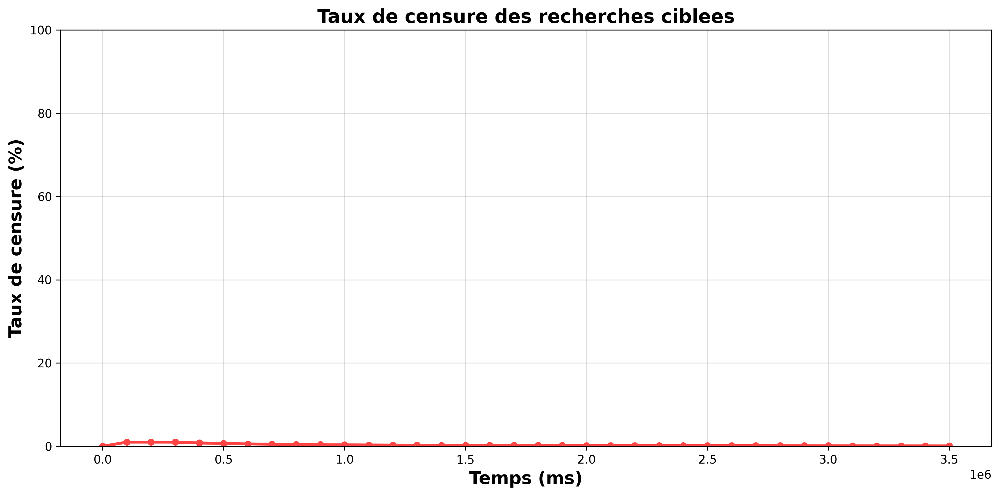
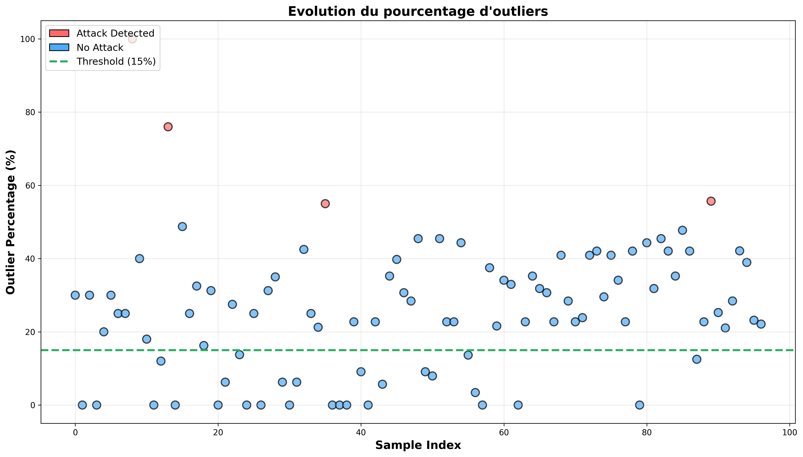

# Défense d'un réseau Kademlia contre une attaque Sybil

Projet de TIPE : simulation d'une **attaque Sybil de type éclipse/censure** sur un réseau pair-à-pair **Kademlia**, puis mise en place d'un mécanisme de **détection statistique** et de **neutralisation** de l'attaque.

La simulation repose sur [PeerSim 1.0.5](http://peersim.sourceforge.net/) et sur l'implémentation Kademlia pour PeerSim de D. Furlan et M. Bonani, modifiée et étendue pour ce projet.

---

## Principe

### L'attaque
Dans Kademlia, chaque nœud possède un identifiant de 160 bits et la proximité entre deux nœuds est mesurée par la distance **XOR**. Une ressource (ou un nœud cible) est retrouvée en interrogeant les **K nœuds les plus proches** de son identifiant.

L'attaquant injecte des nœuds Sybils dont les identifiants sont choisis **très proches de l'identifiant cible** (paramètre `proximity_bits`). Si les K nœuds les plus proches renvoyés lors d'une recherche sont tous des Sybils, la recherche est **censurée** : la cible devient inaccessible.

### La détection
1. **Référence (baseline)** – au temps 0, `BaselineInitializer` mesure, sur un échantillon de nœuds sains, la distribution de la longueur en bits des distances XOR des K plus proches voisins (moyenne μ et écart-type σ).
2. **Recherches de détection périodiques** – toutes les `detection_period` requêtes, plusieurs recherches parallèles vers la cible sont lancées et les nœuds trouvés sont regroupés.
3. **Détection d'anomalies** (`SybilAnomalyDetector`) – un nœud est jugé suspect si la longueur en bits de sa distance à la cible est **anormalement faible** : `bitLength < μ − 2σ`. Si la proportion de ces valeurs aberrantes dépasse **50 %**, l'attaque est déclarée détectée.

### La neutralisation
Lorsqu'une attaque est détectée, l'ensemble `closestKNodes` utilisé pour la recherche est **élargi** (`applyMitigation` dans `KademliaProtocol`) :
- **Filtre A** : ajout des nœuds de la zone anormalement proche (zone Sybil) ;
- **Filtre B** : ajout de quelques nœuds **fiables** de la zone normale `[μ − 2σ, μ + 2σ]`.

Il suffit alors qu'un seul nœud honnête figure parmi les nœuds retenus pour que la censure échoue.

---

## Organisation du dépôt

| Chemin | Contenu |
|---|---|
| `kademlia/src/peersim/kademlia/` | Code Java du protocole Kademlia, de l'attaque, de la détection et de la défense |
| `kademlia/example.cfg` | Configuration principale de la simulation |
| `kademlia/positif.cfg` / `kademlia/negatif.cfg` | Configurations avec 50 Sybils / sans Sybil (témoin) |
| `src/`, `classes/`, `*.jar` | Moteur PeerSim et dépendances (JEP) |
| `simuler.py` | Lance la simulation en série (300 fois par défaut) et calcule le taux de réussite de la défense |
| `graphe.py` | Lit les CSV produits par la simulation et génère les graphiques et `sybil_summary.txt` |
| `*.csv`, `*.png`, `sybil_summary.txt` | Résultats et figures obtenus |
| `Paulin-TIPE-1.pdf` | Document de présentation du TIPE |

### Classes principales ajoutées ou modifiées

| Classe | Rôle |
|---|---|
| `CustomDistribution` | Attribue les identifiants et place les Sybils près de la cible |
| `BaselineInitializer` | Calcule la distribution de référence des distances |
| `TrafficGenerator` | Génère le trafic de recherches et déclenche les recherches de détection |
| `SybilAnomalyDetector` | Détecte les valeurs aberrantes (μ − 2σ, seuil de 50 %) |
| `KademliaProtocol` | Mesure la censure, lance l'analyse et applique la neutralisation |
| `KademliaObserver` | Collecte les statistiques et écrit les fichiers CSV |

---

## Paramètres principaux (`kademlia/example.cfg`)

| Paramètre | Valeur | Signification |
|---|---|---|
| `SIZE` | 5000 | Nombre de nœuds |
| `K` | 20 | Taille des k-buckets |
| `SIM_TIME` | 1 h | Durée simulée |
| `init.1uniqueNodeID.sybil_count` | 30 | Nombre de nœuds Sybils |
| `init.1uniqueNodeID.sybil_target` | — | Identifiant de la cible attaquée |
| `init.1uniqueNodeID.proximity_bits` | 144 | Proximité des Sybils à la cible (≈ 150 bits sans Sybil) |
| `control.0baseline.sample_size` | 500 | Taille de l'échantillon de référence |
| `control.1traffic.detection_period` | 25 | Fréquence des recherches de détection |

Le réseau subit aussi du **churn** (`Turbulence` : 50 % d'ajouts, 50 % de retraits).

---

## Utilisation

Prérequis : **Java (JDK 8 ou plus)** et **Python 3** avec `matplotlib` et `numpy`.

### Compilation (Windows)
```powershell
javac -classpath ".;jep-2.3.0.jar;djep-1.0.0.jar" -d classes "@sources.txt"
```
`sources.txt` contient la liste des fichiers Java à compiler (chemins absolus à adapter à votre machine).

### Lancer une simulation
```powershell
java -classpath "classes;kademlia/classes;jep-2.3.0.jar;djep-1.0.0.jar;peersim-1.0.5.jar" peersim.Simulator kademlia/example.cfg
```
Sous Linux/macOS, remplacer les `;` du classpath par des `:`.

### Lancer une série de simulations
```powershell
python simuler.py
```
Adapter `WORKING_DIR` et `N_SIMULATIONS` en tête du fichier. Le script affiche, pour chaque simulation, la censure finale, l'instant où la défense agit pour la première fois et le nombre de détections, puis un résumé global.

### Générer les graphiques
```powershell
python graphe.py
```

---

## Résultats

Le script `graphe.py` produit notamment :

| Figure | Contenu |
|---|---|
| `network_composition.png` | Nœuds normaux et Sybils au cours du temps |
| `censorship_rate.png` | Taux de recherches censurées |
| `detection_accuracy.png` | Détections positives et négatives |
| `outlier_percentage_evolution.png` | Pourcentage de valeurs aberrantes à chaque test |
| `baseline_distribution.png` | Distribution de référence des distances |
| `nodes_distribution.png` | Distribution des identifiants avec et sans Sybils |
| `mean_bitlength_vs_baseline.png` | Distance moyenne observée comparée à la référence |
| `performance_metrics.png` | Nombre de sauts et latence moyens |




Exemple de résumé obtenu (`sybil_summary.txt`) : réseau de 5 000 nœuds dont 72 Sybils, taux de censure final de 0,10 %, 27 sauts et 1,95 s de latence en moyenne.

---

## Crédits

- **PeerSim** : Alberto Montresor, Márk Jelasity et contributeurs (licence GPL).
- **Kademlia pour PeerSim** : Daniele Furlan et Maurizio Bonani.
- **Attaque Sybil, détection et neutralisation** : Paulin Guillet, dans le cadre du TIPE.
